  

    

  <h1>Tanuj</h1>
  
<strong>Software Engineer &amp; Systems Architect</strong>

  

    Building deterministic simulations, forensic signal-processing pipelines, and spatial 3D web applications.
  

  

    
    
    
  

  

    
      <a href="#about">About</a> &nbsp;·&nbsp;
      <a href="#featured-systems">Featured Systems</a> &nbsp;·&nbsp;
      <a href="#technology-stack">Technology Stack</a> &nbsp;·&nbsp;
      <a href="#contact">Contact</a>
    
  

---

## About

I design and engineer full-stack software systems with an emphasis on **clean architectural boundaries**, **deterministic execution**, and **high-craft interfaces**.

- **Simulation & Game Systems:** Fixed-step 60 Hz engines · Seeded RNG · Typed event bus · Canvas 2D
- **Applied DSP & Forensics:** SHA-256 chain of custody · Speech enhancement · Speaker comparison · Examiner review gates
- **Spatial & Local-First Apps:** Three.js / WebGL · Offline PWA storage · Versioned sync · Spring Boot & FastAPI

---

## Featured Systems

### [Zone Control](https://github.com/usernametan/ant-defence) (`ant-defence`)

**Zone Control** is a deterministic, browser-based top-down tactical arena shooter built with TypeScript, React 18, Canvas 2D, and Web Audio synthesis. A pure 60 Hz seeded simulation engine drives respawning AI, A\* pathfinding, destructible cover, three capture zones, four procedural biomes, Hellcell PvPvE boss encounters, and Rampage free-for-all combat—optimized down to `0.595 ms/step` in `20v20` headless benchmarks via chunked ground caching.

  
  
  

---

### [Audio Forensics Platform](https://github.com/usernametan/forensic-audio-) (`forensic-audio-`)

The **Audio Forensics Evidence Analysis Platform** is a full-stack forensic laboratory workstation built with Python, FastAPI, SQLAlchemy 2.0, and React 18. It preserves original recordings read-only with dual SHA-256 hashing and an immutable audit trail, orchestrates an eight-stage denoising, diarization, ECAPA-TDNN + F0/MFCC speaker comparison, and Whisper ASR pipeline (with deterministic acoustic fallbacks), and locks Section 65B IEA / Section 63 BSA 2023 report exports until a certified examiner completes review.

  
  

---

### [Nexora — Personal Cosmos](https://github.com/usernametan/nexora) (`nexora`)

**Nexora** is a local-first 3D productivity universe built with React 18, React Three Fiber, Three.js, GSAP 3, and an optional Spring Boot 3 / Java 21 cloud sync backend. It organizes daily planning, wellbeing, knowledge files, focus sessions, budgeting, and bookmarks across seven orbiting celestial worlds with procedural WebGL textures, Web Audio ambient synthesis, offline PWA persistence, and Playwright + Axe WCAG 2.1 verification.

  
  
  

---

## Technology Stack

| Domain | Technologies |
| :--- | :--- |
| **Languages** |      |
| **Frontend & 3D** |       |
| **Backend & Data** |       |
| **Audio, DSP & ML** |      |
| **Testing & DevOps** |      |

---

## Contact

- **GitHub:** [github.com/usernametan](https://github.com/usernametan)
- **Email:** [tanujbisht0712@gmail.com](mailto:tanujbisht0712@gmail.com)

---

  Minimal. Deterministic. Auditable. — <a href="https://github.com/usernametan">usernametan</a>

